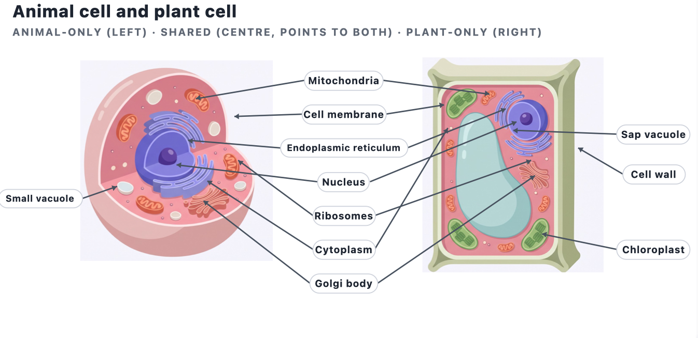

# Cell Structure and Organisation

**Topic at a glance.** Every living thing is built from **cells** — the smallest unit that can carry out all the processes of life. In this topic you learn what a typical animal cell and plant cell are made of, what each part *does*, how the two cell types differ, and how some cells are specially shaped for a particular job. It is the foundation for almost everything later in Biology (respiration happens in mitochondria, photosynthesis in chloroplasts, diffusion across the cell membrane), so it is worth knowing cold. Questions usually ask you to **identify** a structure from a diagram, **state its function**, **compare** animal and plant cells, or **explain** how a specialised cell is adapted to its job.

---

## 1a — Cell structures and their functions

Under a light microscope (with a stain such as iodine or methylene blue) you can see the larger structures of a cell. Both animal and plant cells share some of these; others are found only in plant cells.

### Found in both animal and plant cells

**Cell membrane** (also called the plasma membrane)
A thin layer surrounding the cytoplasm. It is **partially permeable** — it lets some substances through (e.g. oxygen, water, glucose) but not others. This is how it **controls what enters and leaves** the cell. Do not call it "permeable" or "fully permeable" — that mark is lost often.

**Cytoplasm**
A jelly-like fluid (mostly water) that fills the cell and holds the organelles. It is the **site of many chemical (metabolic) reactions**, because the enzymes that run those reactions are dissolved in it.

**Nucleus**
Usually the largest structure, often near the centre. It is surrounded by a **nuclear membrane (envelope)**, and inside it holds the **genetic material (DNA, organised as chromosomes)**. The nucleus **controls the cell's activities** — including protein synthesis and **cell division**. A small dense spot inside it is the *nucleolus*.
*Point a label at the nucleus as a whole, not just at the dark nucleolus in the middle.*

**Cell vacuoles**
Fluid-filled spaces bounded by a membrane. In **animal cells** they are **small, temporary and few** (e.g. to store or digest food). In **plant cells** there is usually **one large, permanent, central vacuole** — see below.

### Found only in plant cells

**Cell wall**
A tough outer layer made of **cellulose**, lying *outside* the cell membrane. It is **fully (freely) permeable**. It gives the cell a **fixed, regular shape** and provides **support and mechanical strength**, and stops the cell bursting when it takes in water. (A cell wall is *not* the same as a cell membrane — the wall is non-living and freely permeable; the membrane is living and partially permeable.)

**Large sap vacuole**
A big, permanent space in the centre filled with **cell sap** (a solution of sugars and salts in water), bounded by a membrane. When full it pushes the cytoplasm against the wall and makes the cell **turgid (firm)**, which helps **support** the plant.

**Chloroplasts**
Green, oval structures containing the pigment **chlorophyll**, which **absorbs light energy for photosynthesis**. Found in the green parts of a plant (e.g. leaf mesophyll), *not* in roots.

| Structure | Found in | Function |
|-----------|----------|----------|
| Cell membrane | Both | Partially permeable; controls what enters and leaves |
| Cytoplasm | Both | Jelly-like; site of chemical reactions |
| Nucleus | Both | Holds genetic material; controls the cell's activities and division |
| Vacuole | Both (large in plant) | Stores cell sap; in plants keeps the cell turgid |
| Cell wall | Plant only | Cellulose; gives shape and support, prevents bursting |
| Chloroplast | Plant only | Contains chlorophyll; absorbs light for photosynthesis |

---

## 1b — Membrane systems and organelles (seen with the electron microscope)

These are too small to see with a light microscope; you identify them from **electron micrographs**. They are present in **both** animal and plant cells.

**Mitochondria** (singular: mitochondrion)
Bean-shaped organelles with a folded inner membrane. They are the **site of aerobic respiration**, where glucose is broken down to **release energy** for the cell. Cells that need a lot of energy (muscle, sperm, root hair) have **many** mitochondria.

**Ribosomes**
Tiny structures, free in the cytoplasm or attached to the endoplasmic reticulum. They are the **site of protein synthesis** (they build proteins from amino acids).

**Endoplasmic reticulum (ER)**
A network of membrane channels through the cytoplasm. It **transports substances (such as proteins) around the cell**. (ER with ribosomes on it is "rough" and handles proteins.)

**Golgi body** (Golgi apparatus)
A stack of flattened, curved sacs. It **modifies, packages and transports proteins** — for example, preparing them to be secreted (released) from the cell.

> **Memory hook:** ribosomes *make* proteins → ER *transports* them → Golgi *packages and ships* them. Mitochondria supply the *energy* for all of it.

---

## 1c — Comparing animal and plant cells

**Both** animal and plant cells have: a cell membrane, cytoplasm, a nucleus, mitochondria, ribosomes, endoplasmic reticulum and a Golgi body.

| Feature | Animal cell | Plant cell |
|---------|-------------|------------|
| Cell wall | Absent | Present (cellulose) |
| Chloroplasts | Absent | Present (in green parts) |
| Vacuole | Small, temporary, if any | One large, permanent, central sap vacuole |
| Shape | Irregular, rounded | Regular, fixed (box-like) |
| Nucleus position | Often central | Often pushed to the side by the vacuole |

**Examiner wants.** Differences stated as a *pair* ("animal cells have **no** cell wall, **whereas** plant cells have a cellulose cell wall"), not just a one-sided list. **Common mistakes:** saying animal cells have "no vacuole" (they can have small ones); forgetting that *both* have mitochondria and a nucleus.

---

## 1d — Specialised cells

Most cells are **specialised**: their structure is adapted to carry out a particular function efficiently. State the **feature** *and* the **reason** it helps — one without the other usually scores half.

**Red blood cell**
- **No nucleus** → more room for **haemoglobin**, so it can carry **more oxygen**.
- **Biconcave disc shape** → a **large surface area to volume ratio**, so oxygen diffuses in and out quickly.
- Contains **haemoglobin**, which binds oxygen to transport it.

**Root hair cell**
- A **long, narrow projection** → a **large surface area** to **absorb water (by osmosis) and mineral ions (by active transport)** from the soil.
- Has **many mitochondria** → release energy for the **active transport** of mineral ions.
- Thin cell wall → short distance for water to cross.

**Muscle cell**
- Has **many mitochondria** → release the large amount of **energy needed for contraction**.
- Can **contract (shorten)** to produce movement.

*(Other examples you may meet: ciliated cells sweep mucus; nerve cells are long to carry impulses; xylem vessels are hollow tubes for water transport. The three above are the syllabus examples.)*

---

## Exam technique
- **Identify / state** → a short, exact answer; name the structure or give the function in a few words.
- **Compare** → always write both sides ("A has…, whereas B has…").
- **Explain how … is adapted** → give **feature + reason** every time (e.g. "many mitochondria *to release energy for* contraction").
- Spell structures correctly: *mitochondria*, *chloroplast*, *nucleus* (plural *nuclei*).

## Common mistakes to avoid
- Writing "permeable" instead of **partially permeable** for the cell membrane.
- Confusing the **cell wall** (cellulose, freely permeable, support) with the **cell membrane** (partially permeable, controls entry/exit).
- Saying the cell wall is "made of cells" — it is made of **cellulose**.
- Giving a feature of a specialised cell with **no reason** (e.g. "it has no nucleus" without "so there is more room for haemoglobin").

## Sample question and model answer

Questions on this topic often combine three skills at once: identifying a structure, comparing the two cell types, and explaining an adaptation. Here is a worked example.

**Question (6 marks)**

(a) Name **one** structure, other than a chloroplast, that is found in a plant cell but not in an animal cell, and state its function. **[2]**

(b) The cell surface membrane is described as *partially permeable*. State what this means. **[1]**

(c) A root hair cell absorbs water and mineral ions from the soil. Explain **two** ways it is adapted to carry out this function. **[3]**

**How to approach it**

- Check the command word. "Name" and "State" want short, exact answers with no explanation. "Explain" in part (c) means you must give a reason, not just a feature.
- Watch the marks. Part (c) is worth 3 marks for "two ways", so give two adaptations and make sure one of them carries an extra explaining point.
- For every adaptation, write **feature + reason** ("it has ..., so that ..."). A feature on its own usually scores only half.
- Use exact terms: *partially permeable* (not "permeable"), *osmosis*, *active transport*.

**Model answer** — each **bold** phrase is the exact keyword that earns the mark; the tag after it says what that 1 mark is for.

**(a)** [2 marks]
- **Cell wall** — *1 mark: naming the structure.*
- made of **cellulose** and gives the cell **shape and support** (or **stops it bursting**) — *1 mark: its function.*

*(A **large, permanent sap vacuole** + its function would also earn the 2 marks.)*

**(b)** [1 mark]
- lets **some substances pass through but not others** — *1 mark.* (Just "lets things through" scores 0 — the "but not others" is the key idea.)

**(c)** [3 marks]
- **long, narrow projection → large surface area** — *1 mark.*
- so **more water and mineral ions are absorbed** — *1 mark.*
- **many mitochondria** to release **energy for active transport** of mineral ions — *1 mark.*

**Why this scores full marks:** every part answers the exact command word, (a) pairs the structure with its function, and in (c) each mark lands on a specific keyword the examiner is looking for — the surface-area idea, the absorption, and the energy-for-active-transport point.

---

## Quick self-test
1. State two structures found in a plant cell but **not** in an animal cell. *(1a, 1c)*
2. Give the function of the cell membrane, and the exact word for how permeable it is. *(1a)*
3. Name the organelle that is the site of (a) aerobic respiration, (b) protein synthesis. *(1b)*
4. Explain two ways a red blood cell is adapted to carry oxygen. *(1d)*
5. Explain why a root hair cell has many mitochondria. *(1d)*

<!-- coverage: 1a, 1b, 1c, 1d -->
