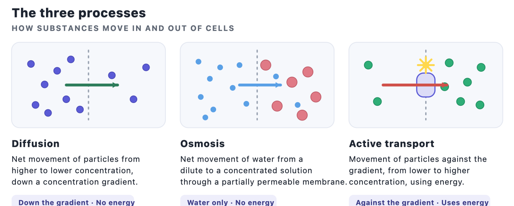

# Movement of Substances

**Topic at a glance.** Cells constantly take in what they need (oxygen, glucose, water, mineral ions) and get rid of waste (carbon dioxide). These substances cross the **cell membrane**, which is **partially permeable**. There are three ways they move: **diffusion**, **osmosis** and **active transport**. The first two are *passive* (no energy used by the cell); the third needs *energy*. Knowing the exact definitions word-for-word, and being able to explain what happens to plant and animal cells in different solutions, is where the marks are.

---

## 2a — Diffusion

**Definition.** Diffusion is the **net movement of particles from a region of higher concentration to a region of lower concentration, down a concentration gradient**, until they are evenly spread. It happens because particles are always moving randomly. It is **passive** — the cell uses **no energy**.

**What speeds it up:**
- a **steeper concentration gradient** (bigger difference)
- a **larger surface area**
- a **shorter distance** to cross (e.g. a thin membrane)
- a **higher temperature** (particles move faster)

**Its role in living things:**
- **Gaseous exchange.** In the lungs, **oxygen** diffuses from the air in the alveoli into the blood, and **carbon dioxide** diffuses from the blood into the alveoli. In a leaf, **carbon dioxide** diffuses in and **oxygen** diffuses out through the stomata.
- **Nutrient uptake.** Digested food such as **glucose** and **amino acids** diffuses from the small intestine into the blood (when it is more concentrated in the gut than in the blood).

**Examiner wants.** The words **"net movement"** and **"down a concentration gradient"**, and that **no energy** is needed. **Common mistake:** saying particles move "from low to high" or that diffusion "needs energy".

---

## 2b — Osmosis

**Definition.** Osmosis is the **net movement of water molecules from a region of higher water potential to a region of lower water potential, through a partially permeable membrane.**

> **Water potential** is just how "free" the water is: a **dilute** solution (lots of water) has a **high** water potential; a **concentrated** solution (little water) has a **low** water potential. Water moves from high to low water potential.

Osmosis is still a type of diffusion (of water), so it is also **passive — no energy** is used.

### Effect on plant cells (they have a cell wall)

| Surrounding solution | What happens | Result |
|----------------------|--------------|--------|
| **Dilute** (higher water potential outside) | Water enters by osmosis; the vacuole swells and pushes the cytoplasm against the wall | **Turgid** (firm). The wall stops it bursting; turgidity **supports** the plant |
| **Same** concentration | No net movement of water | No change |
| **Concentrated** (lower water potential outside) | Water leaves the cell; the vacuole shrinks and the membrane pulls away from the wall | **Flaccid**, then **plasmolysed** |

Because of the strong **cell wall**, a plant cell in water never bursts; it just becomes turgid.

### Effect on animal cells (red blood cell — no cell wall)

| Surrounding solution | What happens | Result |
|----------------------|--------------|--------|
| **Dilute / pure water** (higher water potential outside) | Water enters the cell by osmosis, through the partially permeable membrane | The cell **swells and bursts (haemolysis)** — there is no cell wall to resist the pressure |
| **Same** concentration | No net movement of water | **Normal** shape |
| **Concentrated** (lower water potential outside) | Water leaves the cell by osmosis | The cell **shrinks and becomes crinkled (crenated)** |

**Investigating osmosis.** You can show osmosis with Visking tubing (an artificial partially permeable membrane) or with potato strips: strips in dilute solution gain mass and become firm; strips in concentrated solution lose mass and become soft.

**Examiner wants.** The full definition including **"water molecules"**, **"water potential"** (or dilute→concentrated) and **"partially permeable membrane"**; and that an animal cell **bursts** (no wall) whereas a plant cell becomes **turgid**. **Common mistake:** forgetting "partially permeable membrane", or saying solutes move (only *water* moves in osmosis).

---

## 2c — Active transport

**Definition.** Active transport is the movement of particles **across a membrane against a concentration gradient** (from a **lower** to a **higher** concentration), using **energy released by respiration**, through **carrier (transport) proteins**.

**Why it matters.** It lets a cell absorb a substance **even when there is less of it outside than inside** — so the cell can take up exactly what it needs, selectively. Because it needs energy, it **stops if respiration stops** (e.g. no oxygen, or a poison like cyanide).

**Examples:**
- **Mineral ion uptake by root hair cells** — ions are often more concentrated inside the cell than in the soil, so the plant must use energy to absorb them. (This is why root hair cells have **many mitochondria**.)
- **Glucose uptake in the villi** — cells lining the small intestine use active transport to absorb the last of the glucose from the gut into the blood, against the gradient.

**Examiner wants.** **"against the concentration gradient"** and **"uses energy (from respiration)"** — both are needed for full marks.

---

## The three compared

| | Diffusion | Osmosis | Active transport |
|---|---|---|---|
| **What moves** | Any particles | Water only | Particles (ions/molecules) |
| **Direction** | High → low (down gradient) | High → low water potential | Low → high (against gradient) |
| **Energy needed?** | No | No | **Yes** (from respiration) |
| **Membrane** | Not always | Partially permeable | Partially permeable + carrier proteins |

## Exam technique
- Learn the **three definitions word-for-word** — they are easy marks.
- For "what happens to this cell in this solution?", always say **which way water moves and why** (water potential), then the **result** (turgid / plasmolysed / bursts).
- Mention the **cell wall** when explaining why a plant cell does **not** burst.

## Common mistakes to avoid
- Saying diffusion or osmosis "uses energy" — they do **not**.
- Leaving out **"partially permeable membrane"** from the osmosis definition.
- Saying solute (sugar/salt) moves in osmosis — only **water** moves.
- Forgetting that active transport goes **against** the gradient and **needs energy**.

## Sample questions and model answers

The examiner wants a clear chain of reasoning, not just the result. For osmosis: **(1) compare the water potentials → (2) say which way water moves by osmosis → (3) give the effect on the cell** (and mention the cell wall for plant cells). Below, each **bold** phrase is the keyword that earns the mark.

**1. A red blood cell is placed in pure water. Explain what happens. [3]**
- The pure water has a **higher water potential** than the cell contents — *1 mark.*
- so **water enters the cell by osmosis** (through the partially permeable membrane) — *1 mark.*
- the cell has no cell wall, so it **swells and the membrane bursts (haemolysis)** — *1 mark.*

**2. A plant cell is placed in a concentrated sugar solution. Explain what happens. [3]**
- The solution has a **lower water potential** than the cell sap — *1 mark.*
- so **water leaves the cell by osmosis** — *1 mark.*
- the **membrane and contents pull away from the cell wall (plasmolysis)**; the wall itself keeps its shape — *1 mark.*

**3. Explain why a root hair cell uses active transport to absorb mineral ions, and why it has many mitochondria. [3]**
- Mineral ions are **more concentrated inside the cell than in the soil**, so they must be taken up **against the concentration gradient** — *1 mark.*
- active transport needs **energy from respiration** — *1 mark.*
- the **many mitochondria** release that energy — *1 mark.*

---

## Quick self-test
1. Define diffusion, including the phrase about the concentration gradient. *(2a)*
2. Give one example of diffusion in humans and one in plants. *(2a)*
3. Define osmosis in full. *(2b)*
4. Explain what happens to a red blood cell placed in pure water, and why. *(2b)*
5. Explain why a plant cell becomes turgid but does not burst. *(2b)*
6. Define active transport and give two examples. *(2c)*
7. State the two things that make active transport different from diffusion. *(2c)*

<!-- coverage: 2a, 2b, 2c -->
